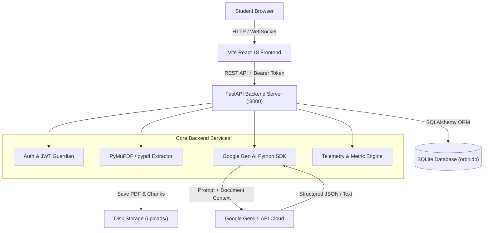

# ORBIT — Gemini StudyMate AI
### *Explore Knowledge. Understand Everything. Learn Beyond Limits.*

[](LICENSE)
[](https://aistudio.google.com)
[](https://fastapi.tiangolo.com)
[](https://vitejs.dev)
[](https://threejs.org)

---

## 🌌 1. Product Overview

**ORBIT – Gemini StudyMate AI** is a next-generation, production-grade educational platform built for university and college students. Unlike generic chatbots or conventional student portals, ORBIT immerses students into a **Futuristic 3D AI Universe** designed to transform textbooks, research papers, and dense lecture slides into structured, verifiable academic mastery.

Powered directly by Google's latest **Gemini API** via the official `google-genai` Python SDK, ORBIT prevents hallucinations by strictly grounding answers in uploaded PDF materials and providing verifiable page citations.

---

## ⚡ 2. The Problem & The ORBIT Solution

| Traditional Student Challenges | The ORBIT AI Solution |
| :--- | :--- |
| **Information Overload:** 80+ page lecture decks and heavy reference books cause cognitive burnout. | **Grounded Document Workspace:** Ingests PDFs page-by-page, allowing students to query specific chapters and receive grounded answers with exact `[Page X]` citations. |
| **Generic Chatbot Hallucinations:** Standard chatbots invent formulas and citations that lead to exam failure. | **Deterministic RAG & Source Attribution:** Distinguishes between verifiable document citations and general AI guidance. Never invents citations. |
| **Rigid Explanations:** Explanations are often either too childish or excessively academic. | **5 Adaptive Study Modes:** Dynamically adapts output across **Beginner**, **Exam**, **Technical**, **Quick Revision**, and **Coding** modes. |
| **Passive Re-reading:** High illusion of competence without genuine retention. | **Adaptive Active Recall Quiz Engine:** Generates MCQs and problem sets directly from notes with instant scoring, timer, and weak-topic diagnostics. |
| **Exam Anxiety & Cramming:** Poor schedule planning leads to last-minute cramming. | **AI Exam Preparation Planner:** Generates realistic day-by-day timetables with active recall checkpoints that respect daily available hours. |

---

## 🎨 3. Futuristic 3D AI Universe Design System

ORBIT rejects generic dashboard templates in favor of a bespoke visual identity inspired by spatial computing and deep-space research labs:

- **Cinematic Deep Space Palette:** Deep Space (`#050611`), Dark Navy (`#0A1024`), Cosmic Blue (`#2563EB`), Electric Cyan (`#22D3EE`), and Neon Violet (`#8B5CF6`).
- **Signature 3D AI Orb:** Built with **Three.js & React Three Fiber**, the interactive 3D orb floats, responds subtly to mouse movement, and changes visual states dynamically:
  - `idle`: Gentle cosmic drift and ambient glow.
  - `listening`: Responsive cyan energy aura.
  - `thinking`: Rapidly rotating equatorial rings and particle acceleration.
  - `generating`: Dynamic pulses during Gemini streaming/synthesis.
  - `completed`: Emerald success burst.
- **Floating Study Dock:** Floating navigational pill with active-state indicators and micro-interactions.
- **Knowledge Constellation:** Interactive SVG node network visualizing student subject mastery and concept connections.
- **Typography Combo:** Headings in **Space Grotesk**, interface text in **Inter**, and technical code in **JetBrains Mono**.

---

## 🛠️ 4. Technology Stack

### Frontend
- **Framework:** React 18 with TypeScript & Vite
- **Styling:** Tailwind CSS with custom futuristic theme & glassmorphism
- **3D Graphics:** Three.js, `@react-three/fiber`, `@react-three/drei`
- **Animations:** Framer Motion & Canvas Confetti
- **Icons:** Lucide React
- **Data Visualizations:** Recharts (Area charts, Bar charts, Responsive containers)
- **Routing:** React Router v6 (Protected routes & auth guards)

### Backend
- **Framework:** Python 3.13 & FastAPI (REST API with OpenAPI documentation)
- **AI Engine:** Official `google-genai` Python SDK (configurable model: `gemini-2.5-flash`, `gemini-1.5-flash`)
- **Document Processing:** PyMuPDF (`fitz`) and `pypdf` for page-level extraction and semantic chunking
- **Database & ORM:** SQLAlchemy with SQLite (isolated tables with foreign keys and cascade rules)
- **Security & Auth:** Cryptographic password hashing (`bcrypt`), JWT Access Tokens (`PyJWT`)

---

## 🏛️ 5. Application Architecture & Data Flow



---

## 🚀 6. Local Setup & Quickstart

### Prerequisites
- **Node.js:** v18+ (Node v24 recommended)
- **Python:** 3.10+ (Python 3.13 supported)
- **Google Gemini API Key:** Free key from [Google AI Studio](https://aistudio.google.com/app/apikey)

### Step 1: Clone Repository
```bash
git clone https://github.com/vmukesharav-sudo/orbit-studymate-ai.git
cd orbit-studymate-ai
```

### Step 2: Configure Backend Environment
```bash
cd backend
cp .env.example .env
```
Edit `backend/.env` with your Google Gemini API key:
```env
GEMINI_API_KEY="AIzaSyYourActualKeyHere..."
GEMINI_MODEL="gemini-2.5-flash"
SECRET_KEY="your-secure-jwt-secret-key"
DATABASE_URL="sqlite:///./orbit.db"
UPLOAD_DIR="uploads"
PORT=8000
```

### Step 3: Install Backend Dependencies & Run
```bash
# In backend/ directory:
pip install -r requirements.txt
python run.py
```
*The backend API will start at `http://localhost:8000` (Interactive API docs at `http://localhost:8000/api/docs`).*

### Step 4: Install Frontend Dependencies & Run
```bash
# In a new terminal window, navigate to frontend/:
cd ../frontend
npm install
npm run dev
```
*The frontend interface will open at `http://localhost:5173`.*

---

## 🧪 7. Automated Testing Suite

ORBIT includes a direct automated test suite covering all critical pathways:
- Schema generation and database migrations
- Password hashing & JWT token validation
- User registration and data isolation
- PDF chunking and keyword relevance retrieval
- Quiz scoring, weak topic diagnostics & percentage calculation
- Study plan milestone scheduling & completion toggling
- Analytics aggregation & streak tracking
- Gemini JSON sanitization

Run the test suite from the project root:
```bash
python tests/test_direct.py
```
Expected output:
```
✔ SQLite Schema Initialized successfully.
✔ Cryptographic Security & JWT Auth: PASS
✔ User Registration & Settings Cascade: PASS
✔ User Authentication Flow: PASS
✔ PDF Chunking & Grounded Relevance Retrieval: PASS
✔ Quiz Grading, Weak-Topic Diagnostics & Scoring: PASS
✔ Study Plan Timetable & Task Lifecycle: PASS
✔ Analytics Aggregation & Learning Metrics: PASS
✔ Gemini JSON Extraction & Sanitizer: PASS
============================================================
ALL 9 TEST SUITES PASSED FLAWLESSLY!
============================================================
```

---

## 🌐 8. Production Deployment Guide (Vercel & Render)

ORBIT is pre-configured with Infrastructure-as-Code for zero-hassle cloud deployment:

### Backend: FastAPI on Render (with Managed PostgreSQL)

Render provides automated CI/CD and managed PostgreSQL:

1. **Deploy with Blueprint (`render.yaml`):**
   - In Render Dashboard, click **New +** -> **Blueprint**.
   - Connect repository `https://github.com/vmukesharav-sudo/orbit-studymate-ai`.
   - Render automatically provisions the **FastAPI Web Service** and a **PostgreSQL Database** linked via `DATABASE_URL`.
2. **Required Environment Variables on Render:**
   - `GEMINI_API_KEY`: Your real Google Gemini API key from AI Studio.
   - `GEMINI_MODEL`: `gemini-2.5-flash`
   - `SECRET_KEY`: High-entropy string for JWT signing (Render auto-generates this if using `render.yaml`).
   - `ENVIRONMENT`: `production`
   - `DATABASE_URL`: Automatically populated from the Render managed PostgreSQL database (`postgresql://...`).

### Frontend: React + Vite on Vercel

Vercel provides edge hosting and automatic SSL:

1. **Import Project to Vercel:**
   - In Vercel Dashboard, click **Add New...** -> **Project**.
   - Select `orbit-studymate-ai`.
   - Set **Framework Preset**: `Vite`.
   - Set **Root Directory**: `frontend` (or leave as `./` — root `vercel.json` handles monorepo build).
2. **Configure Environment Variables on Vercel:**
   - `VITE_API_URL`: Your deployed Render backend URL, e.g.:
     ```text
     https://orbit-studymate-backend.onrender.com/api
     ```
3. **Deploy:** Click **Deploy**. Vercel will build the frontend and serve it with client-side SPA routing (`vercel.json`).

---

## 📚 9. REST API Endpoints Overview

| Method | Endpoint | Description |
| :--- | :--- | :--- |
| `POST` | `/api/auth/register` | Register student with email, password, full name |
| `POST` | `/api/auth/login` | Authenticate student and issue JWT token |
| `GET` | `/api/auth/me` | Fetch authenticated user profile |
| `POST` | `/api/documents/upload` | Upload PDF, extract pages, compute structural metadata |
| `GET` | `/api/documents` | List uploaded documents for current student |
| `GET` | `/api/documents/{id}` | Retrieve document text and page breakdown |
| `DELETE`| `/api/documents/{id}` | Delete document from disk and database |
| `POST` | `/api/ai/chat` | Send message to Ask ORBIT with selected Study Mode |
| `GET` | `/api/ai/conversations` | List saved chat sessions |
| `POST` | `/api/ai/summarize` | Synthesize short/detailed/chapter summaries with definitions |
| `POST` | `/api/quizzes/generate` | Generate interactive recall quiz from topic or PDF |
| `POST` | `/api/quizzes/{id}/submit`| Submit quiz answers for grading & diagnostic review |
| `POST` | `/api/study-plans/generate` | Generate realistic daily timetable leading up to exam |
| `PATCH`| `/api/study-plans/tasks/{id}`| Toggle completion status of scheduled study task |
| `GET` | `/api/analytics/overview` | Fetch activity telemetry, streak, score curves, and AI insights |
| `GET` | `/api/settings` | Get student study preferences and Gemini API status |
| `PATCH`| `/api/settings` | Update settings and runtime Gemini API key |

---

## 🔒 10. Security & Privacy Architecture

1. **Strict User Isolation:** All database queries filter explicitly by `user_id == current_user.id`. One student cannot read, edit, or delete another student's materials.
2. **Hidden Exam Integrity:** When generating quizzes, correct answers and detailed explanations are **omitted** from the client payload during the quiz attempt. Scoring is performed exclusively on the backend upon submission.
3. **Server-Side API Key Protection:** The Google Gemini API key is never bundled or sent to the client browser. All calls route through FastAPI.
4. **Input Sanitation & Size Limits:** PDF uploads are capped at 25MB and validated against corrupt binaries or encrypted locks.

---

## 👨‍💻 11. Author & Project Credits

- **Developer:** Mukesh Arav V.
- **GitHub:** [@vmukesharav-sudo](https://github.com/vmukesharav-sudo)
- **Project Name:** ORBIT — Gemini StudyMate AI
- **License:** MIT License

---

*“Learn beyond the limits with Google Gemini.”*

